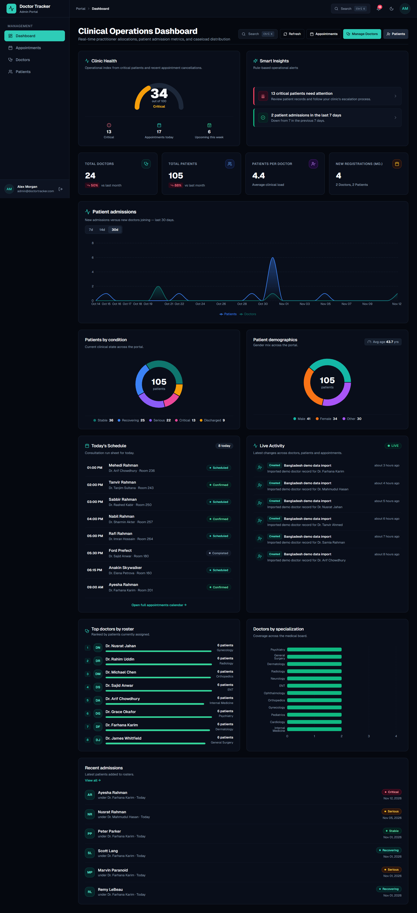
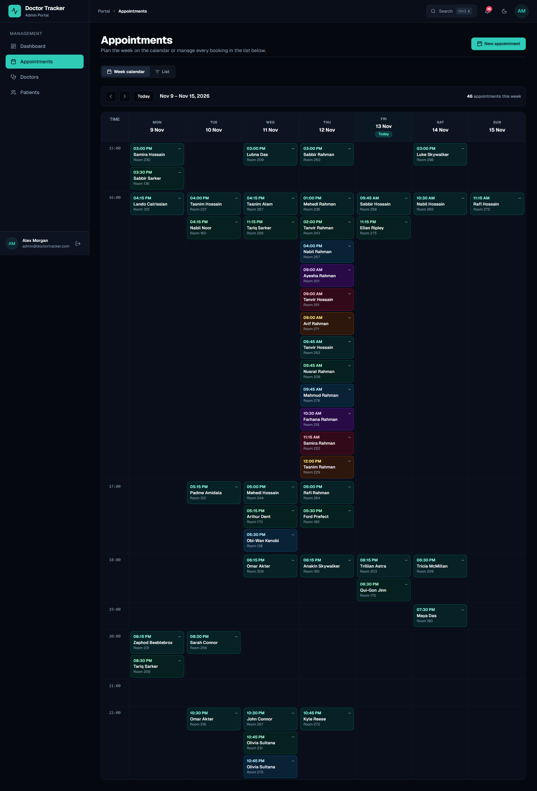
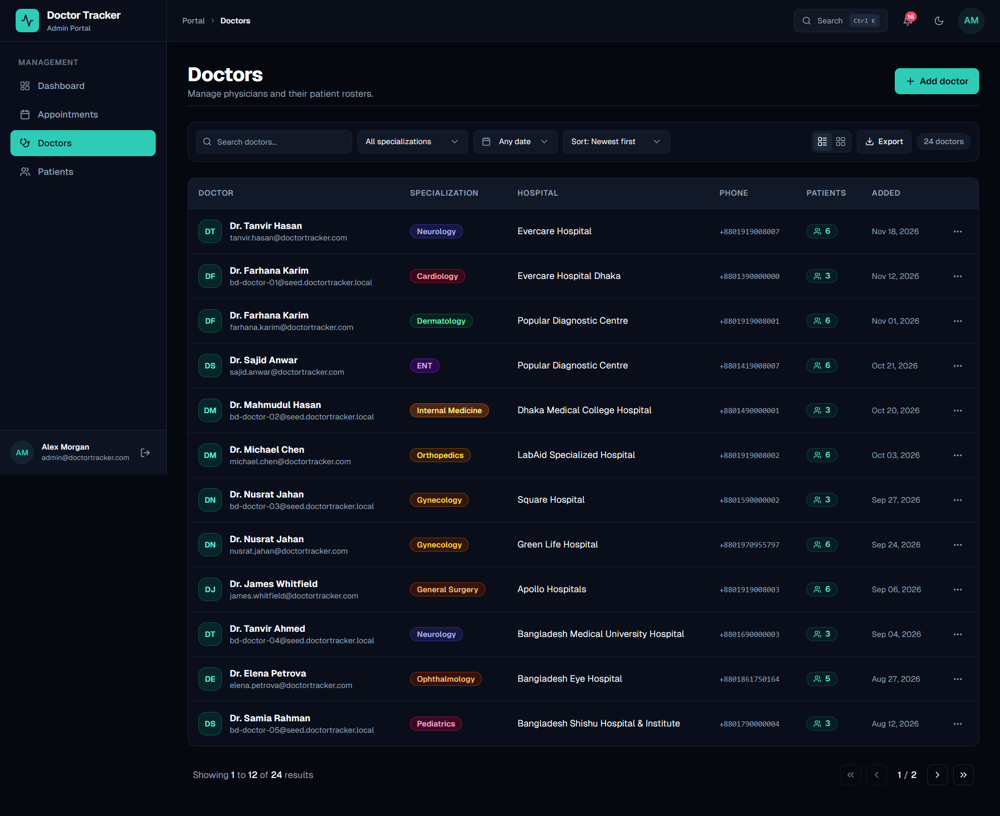
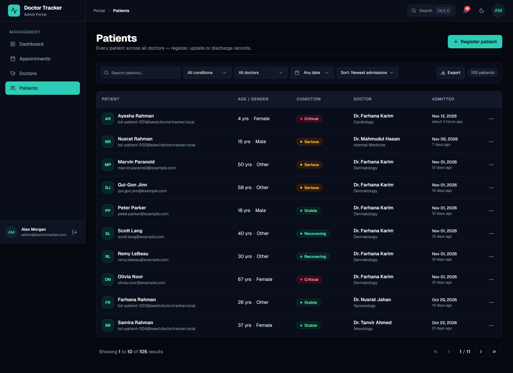

# Doctor Tracker — Clinical Management & Healthcare Analytics Portal

[](https://nextjs.org/)
[](https://www.typescriptlang.org/)
[](https://tailwindcss.com/)
[](https://www.mongodb.com/)
[](https://opensource.org/licenses/MIT)

---

## 1. Description (Elevator Pitch)

**Doctor Tracker** is an administrative healthcare portal for physician directories, patient assignments, appointments, and clinical workload analytics. Built with Next.js 16 and MongoDB Atlas, it uses paginated queries, indexed filters, and client-side caching to keep navigation responsive while keeping records in the database.

**Live demo:** [doctor-tracker-eight-beryl.vercel.app](https://doctor-tracker-eight-beryl.vercel.app/) · **Source code:** [GitHub repository](https://github.com/anik-paul-dev/Doctor-Tracker)

---

## 2. Setup Guide

Follow these steps to set up and run the Doctor Tracker full-stack application on your local machine.

### Prerequisites
- **Node.js**: v18.17.0 or higher (Node 20+ recommended)
- **Package Manager**: `pnpm` (recommended), `npm`, or `yarn`
- **MongoDB**: A free MongoDB Atlas cluster connection URI (or local MongoDB v6.0+)

### Step-by-Step Installation

1. **Clone the repository:**
   ```bash
   git clone https://github.com/anik-paul-dev/Doctor-Tracker.git
   cd doctor-tracker
   ```

2. **Install dependencies:**
   ```bash
   pnpm install
   # or: npm install
   ```

3. **Configure Environment Variables:**
   Copy the `.env.example` file to `.env.local`:
   ```bash
   cp .env.example .env.local
   ```
   Open `.env.local` and provide your MongoDB connection string and secret key:
   ```env
   MONGODB_URI=mongodb+srv://<username>:<password>@cluster0.mongodb.net/doctor-tracker?retryWrites=true&w=majority
   JWT_SECRET=your-secure-64-character-random-hex-string
   ADMIN_REGISTRATION_ENABLED=false
   ```

4. **Seed the Database (Optional but Recommended):**
   Add Bangladesh-based synthetic demo records for 12 doctors, 36 patients, 72 appointments, and activity history. The import is repeat-safe and preserves existing records:
   ```bash
   pnpm seed
   # or: npx tsx src/scripts/seed.ts
   ```
   On an empty database, the seed script also creates the documented demo administrator. Its published password is for disposable interview/demo databases only. Registration is disabled by default; if you prefer a private account, temporarily enable first-account registration, create it, then disable registration again.

5. **Start the Development Server:**
   ```bash
   pnpm dev
   ```
   Open [http://localhost:3000](http://localhost:3000) in your browser.

6. **Demo Administrator Credentials:**
   | Role | Email | Password |
   |------|-------|----------|
   | **Super Admin** | `admin@doctortracker.com` | `password123` |

### Deploy from GitHub to Vercel

1. Push this repository to GitHub, then import it from **Vercel → Add New → Project**.
2. Keep the project root as the repository root. Vercel detects Next.js and pnpm from `package.json` and `pnpm-lock.yaml`; leave the build command, output directory, and install command at their detected defaults. This project does not need a `vercel.json` file.
3. Add these environment variables in the Vercel project settings for **Production** and **Preview**:

   | Key | Value |
   |-----|-------|
   | `MONGODB_URI` | MongoDB Atlas connection URI, including the `doctor-tracker` database name |
   | `JWT_SECRET` | A private, randomly generated secret of at least 32 characters |
   | `ADMIN_REGISTRATION_ENABLED` | `false` |

   Keep `JWT_SECRET` and `MONGODB_URI` server-only; do not prefix them with `NEXT_PUBLIC_`. Keep registration disabled in deployed environments. After saving the variables, deploy or redeploy the project.
4. Ensure the Atlas cluster's network access rules allow requests from Vercel. Vercel uses dynamic outbound IP addresses, so an Atlas allowlist may need broader access unless you configure a supported static/private connection option. Use a strong database password and a database user with only the permissions this application needs.

Vercel's Hobby plan is intended for personal projects. Check its current usage limits before using the deployment for production workloads.

---

## 3. System Architecture

Doctor Tracker employs a **Full-Stack Monorepo Architecture** using the Next.js 16 App Router with strict multi-layered decoupling between presentation, client caching, route handlers, service business logic, and database persistence.

**Chosen specification option:** Next.js provides both the frontend and backend. The UI calls REST endpoints implemented as Next.js Route Handlers, which call service modules and Mongoose models backed by MongoDB. This repository does not run a separate Express server; the specification lists integrated Next.js and a separate Next.js + Express deployment as alternatives.

```
┌────────────────────────────────────────────────────────────────────────┐
│                        PRESENTATION & CLIENT LAYER                     │
│                                                                        │
│   Next.js 16 App Router (React 19 Server & Client Components)          │
│   ┌───────────────────┐  ┌───────────────────┐  ┌───────────────────┐  │
│   │  Analytics Dash   │  │ Doctor Directory  │  │ Patient Directory │  │
│   │ (Recharts Viz)    │  │  (CRUD + Filters) │  │  (CRUD + Search)  │  │
│   └─────────┬─────────┘  └─────────┬─────────┘  └─────────┬─────────┘  │
│             │                      │                      │            │
│             └──────────────────────┼──────────────────────┘            │
│                                    ▼                                   │
│            ┌──────────────────────────────────────────────┐            │
│            │   TanStack Query v5 (React Query Cache)      │            │
│            │   - Stale-while-revalidate caching           │            │
│            │   - Query invalidation on mutations          │            │
│            │   - Cached server data and mutation refresh   │            │
│            └──────────────────────┬───────────────────────┘            │
└───────────────────────────────────┼────────────────────────────────────┘
                                    │ HTTP (RESTful JSON + Cookie Auth)
                                    ▼
┌────────────────────────────────────────────────────────────────────────┐
│                        BACKEND & API SERVICES LAYER                    │
│                                                                        │
│   Next.js Node.js Route Handlers (/api/*)                              │
│   ┌────────────────────────────────────────────────────────────────┐   │
│   │ API Route Handlers: JWT Verification (httpOnly Cookies)        │   │
│   │ Input Validation: Zod Type-Safe Schema Guard                   │   │
│   │ Standardized Envelope: { success, data, pagination, error }   │   │
│   └───────────────────────────────┬────────────────────────────────┘   │
│                                   ▼                                    │
│   ┌────────────────────────────────────────────────────────────────┐   │
│   │ Business Service Layer:                                        │   │
│   │ - auth.service.ts      - doctor.service.ts                     │   │
│   │ - patient.service.ts   - dashboard.service.ts                  │   │
│   └───────────────────────────────┬────────────────────────────────┘   │
│                                   ▼                                    │
│   ┌────────────────────────────────────────────────────────────────┐   │
│   │ Data Access Layer (Mongoose 8 Singleton Pool)                  │   │
│   │ Models: User, Doctor, Patient, Appointment, Activity           │   │
│   │ Indexes: Text Index, Compound Spec/Hospital, Date Timestamps   │   │
│   └───────────────────────────────┬────────────────────────────────┘   │
└───────────────────────────────────┼────────────────────────────────────┘
                                    │
                                    ▼
┌────────────────────────────────────────────────────────────────────────┐
│                      PERSISTENCE (MONGODB ATLAS)                       │
│                                                                        │
│   Collections: users (auth), doctors (roster), patients (records)      │
│   Aggregation Pipelines: $facet, $group, $match, $lookup, $project     │
└────────────────────────────────────────────────────────────────────────┘
```

### Data Flow Breakdown
1. **Authentication Flow**: User submits credentials $\rightarrow$ `POST /api/auth/login` validates schema $\rightarrow$ compares bcrypt password hash $\rightarrow$ generates signed JWT $\rightarrow$ sets an `httpOnly`, `SameSite=Lax` cookie $\rightarrow$ API route handlers verify the signature before data access. Middleware checks cookie presence for routing; it is not the API authorization boundary.
2. **Read/Filter Flow**: UI input updates search state $\rightarrow$ 300ms debounce hook triggers $\rightarrow$ TanStack Query issues GET request with query params $\rightarrow$ API Handler runs optimized MongoDB queries $\rightarrow$ returns standardized JSON payload $\rightarrow$ component renders with zero layout shift.
3. **Mutation Flow**: Modal form submits $\rightarrow$ client validates Zod schema $\rightarrow$ TanStack mutation dispatches $\rightarrow$ backend route authenticates and validates again $\rightarrow$ service applies database writes and updates related records/counters $\rightarrow$ cache invalidates $\rightarrow$ Sonner toast displays confirmation.

---

## 4. Technical Decisions (Deep Dive)

### Decision 1: TanStack Query (React Query v5) over Redux Toolkit
- **Problem Context**: Doctor Tracker is a data-intensive administrative dashboard requiring frequent server synchronization (paginated tables, live search, filtered aggregations, chart updates), rather than deep multi-step client UI state.
- **Why TanStack Query Was Chosen**:
  1. **Server-State vs. Client-State Separation**: Redux requires extensive boilerplate (slices, reducers, thunks, selectors, actions) to manage what is ultimately just remote server data. TanStack Query treats server data as a cache, handling loading, error, deduplication, and stale timing out of the box.
  2. **Cache Invalidation & Consistency**: Patient mutations invalidate patient, doctor, doctor-patient, and dashboard queries so the related views refresh from the database.
  3. **Focused State Management**: TanStack Query handles remote server data; React state handles local UI state such as dialogs, filters, and selected views. This avoids a second global store for data already owned by the server.

### Decision 2: Integrated Next.js Route Handlers over a Separate Express Server
- **Problem Context**: The interview specification allows either an integrated Next.js application or a separate Next.js frontend with an Express backend. This repository uses the integrated Next.js option.
- **Why Full-Stack Next.js 16 Was Chosen**:
  1. **End-to-End TypeScript Type Safety**: Both frontend forms and backend API route handlers share the exact same Zod validation schemas (`CreateDoctorInput`, `CreatePatientInput`) and TypeScript interfaces (`Doctor`, `Patient`, `DashboardData`). Any database schema change produces immediate compile-time errors in the frontend.
  2. **One Same-Origin API**: Route Handlers expose the REST API from the same app, avoiding a separately deployed API origin and its CORS configuration.
  3. **Server-Side Persistence**: Mongoose and database credentials stay in server-side modules; the browser communicates through authenticated JSON endpoints.

---

## 5. Visual Evidence & UI Showcase

The following screenshots show the populated application. The supplied images are desktop captures; add a mobile-sized capture before submission to complete the specification's desktop and mobile evidence requirement.

### Dashboard



### Appointments



### Doctors



### Patients



### Desktop View Highlights
- **Executive Operations Dashboard**: 4 key statistical metric cards with month-over-month growth indicators, monthly registration area trends, specialization donut distribution, and physician workload bar chart.
- **Physician Roster**: Paginated data grid with specialty badges, hospital affiliations, active caseload counters, and direct links to corresponding patient rosters.
- **Physician Profile & Patient Linkage**: Deep-dive profile header showing contact credentials, hospital affiliation, and assigned patient roster with in-place admission and discharge dialogs.
- **Patient Directory**: Hospital-wide patient registry featuring instant sub-string text search, medical condition badges, attending doctor links, and pagination.
- **Light & Dark Theme Engine**: Full system theme synchronization with custom CSS variables (Teal `#0F766E` brand identity).

### Responsive Mobile Experience
- Mobile drawer navigation sheet triggered via top app header.
- Touch-friendly action buttons and responsive data tables with horizontal scroll capability.
- Stacked metric cards and responsive charts fitting all phone viewport dimensions (iPhone, Pixel, iPad).

### Extra Features I Built

I wanted Doctor Tracker to feel useful in the rhythm of a real clinic, not just demonstrate create, edit, and delete forms. Alongside the requested doctor, patient, and analytics workflows, I added features that help an administrator see what needs attention and move around the portal quickly:

- **A working appointment planner:** switch between a week calendar and a searchable, filterable list; create, update, reschedule, and manage appointment status from the same page.
- **A clearer picture of clinic activity:** the dashboard brings together clinic health indicators, data-driven suggestions, today's schedule, recent admissions, and patient activity so administrators can spot changes without opening every record.
- **More useful ways to read the data:** compare admission trends over 7, 14, or 30 days, and explore patient conditions, demographics, doctor workloads, and specialty distribution through charts.
- **Contextual notifications:** review schedule items, dashboard insights, and recent record changes in one place, then mark them read or dismiss them.
- **Quick access across the portal:** use the command search to jump to pages, find doctors and patients, switch themes, or sign out without navigating through menus.
- **Administrator account controls:** update profile details and change the account password from the settings page, with a light and dark theme available throughout the portal.

---

## 6. REST API Reference

| Method | Endpoint | Description | Auth Required |
|--------|----------|-------------|:-------------:|
| `POST` | `/api/auth/register` | Register new administrator | No |
| `POST` | `/api/auth/login` | Authenticate and obtain session cookie | No |
| `POST` | `/api/auth/logout` | Terminate session and clear cookie | Yes |
| `GET` | `/api/auth/me` | Fetch active authenticated admin user | Yes |
| `GET` | `/api/doctors` | List doctors (with search, specialization, date filters & pagination) | Yes |
| `POST` | `/api/doctors` | Create new doctor profile | Yes |
| `GET` | `/api/doctors/:id` | Retrieve single doctor details | Yes |
| `PUT` | `/api/doctors/:id` | Update doctor profile | Yes |
| `DELETE` | `/api/doctors/:id` | Delete doctor and cascade-delete assigned patients | Yes |
| `GET` | `/api/doctors/:id/patients` | Retrieve patients assigned to a specific doctor | Yes |
| `POST` | `/api/doctors/:id/patients` | Register a new patient under this specific doctor | Yes |
| `GET` | `/api/patients` | List all patients (with search, condition, date filters & pagination) | Yes |
| `POST` | `/api/patients` | Register patient with attending doctor assignment | Yes |
| `GET` | `/api/patients/:id` | Retrieve single patient record | Yes |
| `PUT` | `/api/patients/:id` | Update patient record | Yes |
| `DELETE` | `/api/patients/:id` | Discharge/delete patient and decrement doctor count | Yes |
| `GET` | `/api/dashboard/stats` | Aggregated analytics (metrics, trends, distributions) | Yes |

---

## 7. Project Documentation

Comprehensive project documentation is maintained in the `/docs` folder:
- [`architecture.md`](./docs/architecture.md) — High-level architecture, data flow diagrams, and MongoDB indexing strategies.
- [`implementation.md`](./docs/implementation.md) — Complete implementation guide, tech stack inventory, and API contracts.
- [`design.md`](./docs/design.md) — Design system specifications, color palettes, typography, and component hierarchy.
- [`rules.md`](./docs/rules.md) — Code conventions, folder structure rules, and security guidelines.
- [`task.md`](./docs/task.md) — Phase-by-phase development checklist and status tracking.
- [`memory.md`](./docs/memory.md) — Architectural memory and decision logs.

